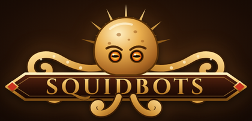

  

# Dungeon Clear (SquidBots)

**Dungeon Clear for Conquest of Azeroth.** A tank bot runs the dungeon for your
party: it routes from boss to boss, pulls the trash on the way, loots, rests,
opens the doors and plays the scripted events. You deal damage, heal, or tank
yourself and let the bots follow your lead.

This module is built for the Conquest of Azeroth core and
[SquidBots](https://github.com/Zyth45/mod-playerbots) (CoA classes, CoA
dungeons and raids). It is not meant for a classic WotLK AzerothCore server.

**Latest version: [v3.1.4](https://github.com/Zyth45/mod-dungeon-clear/tree/v3.1.4)**,
shipped with SquidBots 3.1.4.

**Discord (support, news, new versions): https://discord.gg/DTJceaG9Ky**

## Get it

The easy way is the **[SquidBots Server launcher](https://github.com/Zyth45/squidbots-launcher)**:
it installs and updates a Conquest of Azeroth server with SquidBots and Dungeon
Clear on your own PC, from your own game client.
[squidbots-updates](https://github.com/Zyth45/squidbots-updates) keeps an
existing CoA Bots repack, the addon and the dashboard up to date.

To build it yourself:

1. Clone this repository into `modules/mod-dungeon-clear/`, next to
   [SquidBots](https://github.com/Zyth45/mod-playerbots) in `modules/mod-playerbots/`.
2. Re-run CMake and rebuild the worldserver.
3. Copy `conf/mod_dungeon_clear.conf.dist` to `mod_dungeon_clear.conf` if you
   want to change a setting.

Dungeon Clear extends the SquidBots AI engine (strategies, actions, triggers and
values): it does not run without it.

## The addon

The **[SquidBots Lite addon](https://github.com/Zyth45/squidbots-addon)** is the
easiest way to drive a clear. Its Dungeon button opens the Dungeon clear panel:
On, Off, Pause and Skip, the boss list with Go buttons, the pull mode, a live
status line, and settings you can change for the current run. The panel opens
by itself once when you enter a dungeon or a raid. The `dc` chat keywords and
the `.dc` commands below do the same things.

## What it does

While a clear runs, the tank bot handles the dungeon end to end:

- **Routing** from boss to boss over the live navigation mesh, with no
  hand-made waypoints: long corridors, doors, and dungeons with several wings.
- **Pulling trash** on the way to each boss, in the pull mode you choose
  (see [Pull modes](#pull-modes)).
- **Scripted events** that gate progress: levers, gongs, altars, freed
  prisoners, escorts, wave fights and drops between levels
  (see [Scripted events](#scripted-events)).
- **Looting** with a quality floor, so the party does not wait on corpses with
  nothing worth taking.
- **Resting** between fights, on the bots' own eat and drink thresholds.
- **Party support**: followers stay with the tank, healers keep it in line of
  sight, and the group regroups after a fight pulls it apart.
- **Death recovery**: when someone dies and a living member can resurrect
  (Priest, Paladin, Shaman, Druid, or any CoA class that knows a resurrection
  spell), the run waits for the rez and goes on. It ends on a full wipe, with
  nobody able to rez, or on timeout.
- **Heroic and Mythic dungeons**: the tank pulls more carefully, and several
  settings have their own heroic value. A realm chooses which difficulties
  players may clear (`DungeonClear.AllowedDifficulties`).

## You tank, the bots follow

You can tank yourself. Open the **Main Tank** bar of the SquidBots Lite addon
(or type `tank main on`): you lead, and Dungeon Clear stops driving. The bots
keep its party side: healers place on you, DPS wait for your threat, and
followers left behind regroup on you. `dc on` is refused while a member of the
group is the main tank, so the two modes never fight over the party.

A clear driven by Dungeon Clear always needs a **bot** as tank. You can also
turn your own character into a bot (`.playerbots bot self`) and let it drive.

## Commands

The commands act on the group's tank bot. They must come from a real player in
the group, and `.dc on` works inside a dungeon only.

| Command | Party chat | What it does |
|---|---|---|
| `.dc on` | `dc on` | Start the clear. |
| `.dc off` | `dc off` | Stop, and give the bots back to you. |
| `.dc pause` | `dc pause` | Hold in place; the same command resumes. |
| `.dc skip` | `dc skip` | Skip the current objective when the tank is stuck. |
| `.dc pull` | `dc pull` | Change the pull mode. |
| `.dc status` | `dc status` | Show the run status. |
| `.dc bosses` | `dc bosses` | List the bosses and which are dead. |
| `.dc go <boss>` | | Go straight to a boss. |
| `.dc wing [wing]` | `dc wing` | Show or choose the wing (Blackrock Spire: `lbrs` or `ubrs`). |
| `.dc config` | | Show the settings in effect for this run. |
| `.dc spectate` | | Free camera; `.dc spectate follow [name]` rides a bot. |

Game masters also have `.dc test`, an automated test harness (see
[Test runs](#test-runs)).

## Pull modes

| Mode | Behaviour | Speed | Risk |
|---|---|---|---|
| **Dynamic** *(recommended)* | Chooses per pack: runs into a small pack, pulls a big or clustered one back to a safe spot. | Middle | Middle |
| **Leeroy** | Runs into every pack and fights where it stands. | Fastest | Highest |
| **Advanced** | Pulls every pack back to a safe spot first. | Slowest | Lowest |

Dynamic counts how many mobs would join the fight and compares that with
`DungeonClear.PullDynamicMaxLeeroyMobs`. Use Leeroy when you outgear the
dungeon, Advanced when every pull matters.

## Scripted events

Dungeon Clear plays the scripted steps of the classic dungeons as part of the
route, with no input from you: Deadmines, Wailing Caverns, Shadowfang Keep,
Blackfathom Deeps, Razorfen Downs, Scarlet Monastery, Uldaman, Zul'Farrak,
Maraudon, Sunken Temple, Blackrock Depths, Blackrock Spire, Dire Maul,
Scholomance and Stratholme. In raids it handles the encounter steps of Molten
Core, Zul'Gurub and Blackwing Lair, while the bots' raid strategies fight the
bosses.

Faction events run only for the right side, and heroic-only events never fire
on a normal run. When a step cannot be completed (an escorted NPC died, for
example), the run either waits for you or skips the step, depending on whether
the step is required.

## Configuration

Every `DungeonClear.*` setting is in `conf/mod_dungeon_clear.conf.dist`, with
its description and default. Most can be changed for the current run from the
addon's settings. Common ones: loot quality floor, rest health and mana, pull
tuning, allowed difficulties.

- Append `.Heroic` to a setting to give it a heroic value
  (`DungeonClear.PullDynamicMaxLeeroyMobs.Heroic = 2`). Order: run override,
  then `<key>.Heroic`, then `<key>`, then the built-in default. `.dc config`
  marks heroic defaults with an `H`.
- `DungeonClear.Enable = 0` keeps the module built in but completely inert.
  It is read once at startup.
- **Startup check**: with `DungeonClear.StartupCheck = 1`,
  `AiPlayerbot.StartupCheckOnly = 1` or `CoA.ValidationMode = 1`, the module
  loads and does nothing, so a server can check that a worldserver starts
  without any bot activity. It is also inert when `AiPlayerbot.Enabled = 0`.
  All of these are off by default.

At startup the module tells SquidBots its version, so the server log and the
addon show which Dungeon Clear is built in.

## Test runs

`.dc test` is a **game master** tool, not part of normal play. One command
builds a random 5-bot party (tank, healer, three DPS), levels and gears it,
sends it to a dungeon and lets it clear on its own while you watch
(`.dc test watch`). Each run keeps its seed, so a run that hits a bug can be
replayed with the same party, and `.dc test plan` runs a dungeon several times
to give a success rate. The `testdeck/` folder holds a web page to start and
watch these runs.

The module's unit tests build with `-DBUILD_TESTING=ON` and run with ctest
(`dungeon_clear_tests`).

## License

AGPL-3.0-or-later. `LICENSE` holds the full text; `NOTICE` holds the copyright
line (Jared Wright and contributors) and the note on the playerbots license.
